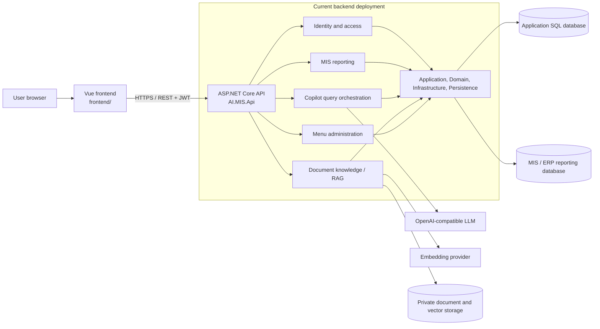
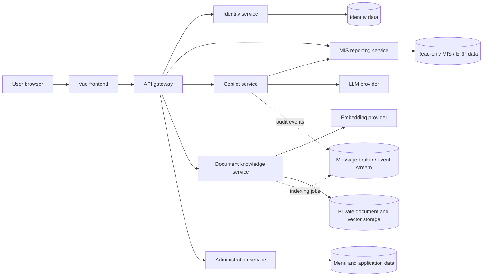

# AI MIS & ERP Copilot

A Vue web client and ASP.NET Core API for MIS and ERP reporting, analytics, and a read-only AI copilot.

## Architecture

The repository is organized into separate frontend and backend applications. The backend currently runs as one deployable API with Clean Architecture layers. Its feature areas are modular, but they are **not independent microservices yet**.



### Proposed microservices architecture

This is a possible target as the application grows. These services and the gateway are **not implemented or deployed separately yet**.



In this target, each service would be independently deployable and own its data and configuration. Services would communicate through versioned HTTP APIs for synchronous operations and events for background work such as audit processing and document indexing. A gateway would provide a single frontend entry point and centralize routing and cross-cutting policies.

### Current project structure

```text
frontend/                         Vue 3 + TypeScript application
backend/
├── AI.MIS.Api/                   HTTP API, authentication, and composition root
├── AI.MIS.Application/           Use cases and application contracts
├── AI.MIS.Domain/                Business entities
├── AI.MIS.Infrastructure/        SQL, LLM, RAG, and other adapters
├── AI.MIS.Persistence/           Persistence configuration
└── database/                     SQL schema and seed scripts
AI.MIS.Copilot.sln                .NET solution
```

### Service boundaries for future extraction

The API already groups functionality that can become separate services as deployment and scaling needs require:

- **Identity and access:** login, users, roles, and branch authorization.
- **MIS reporting:** dashboard and report queries against the reporting database.
- **Copilot:** natural-language interpretation, query validation, authorization, and audit logging.
- **Document knowledge:** document upload, indexing, retrieval, and grounded answers.
- **Menu administration:** menu catalog and user-specific visibility.

Extracting a module into a microservice requires more than moving its folder. Each service should have its own deployable host, stable API or event contract, configuration and health checks, and clearly owned data. Until that work is done, run and deploy the backend as the single API described below.

## Features

- JWT login and role-based access for Administrators, MIS Analysts, and Branch Users.
- MIS dashboard and reporting endpoints.
- Authenticated Excel/CSV import saved to `AiMisErpCopilotDb` before reports are displayed, with selectable grouping and measures, graphical summaries, totals, and a worksheet preview. Imported workbooks are scoped to the signed-in user.
- Natural-language question interpretation and guarded read-only SQL query execution.
- PDF, DOCX, TXT, and Markdown upload, indexing, search, and cited answers using retrieval-augmented generation (RAG).
- Menu and user access administration.
- Vue-based dashboard, visualization, document, and administration pages.

## Requirements

- .NET 9 SDK
- Node.js and npm
- SQL Server databases configured for the application and MIS reporting workloads

## Run locally

### 1. Configure the API

Set secrets from the repository root. Use a secure, random JWT signing key of at least 32 characters and database credentials appropriate for your environment:

```powershell
$env:Authentication__SigningKey = 'replace-with-a-random-key-of-at-least-32-characters'
$env:ConnectionStrings__ApplicationDatabase = 'Server=...;Database=AiMisErpCopilotDb;Trusted_Connection=True;TrustServerCertificate=True;'
$env:ConnectionStrings__MISDbConnection = 'Server=...;Database=...;Trusted_Connection=True;TrustServerCertificate=True;'
```

Keep credentials out of source control. For local development, .NET User Secrets can hold configuration for the API project:

```powershell
dotnet user-secrets set 'Authentication:SigningKey' '<random-signing-key>' --project backend/AI.MIS.Api
dotnet user-secrets set 'ConnectionStrings:ApplicationDatabase' '<application-database-connection-string>' --project backend/AI.MIS.Api
dotnet user-secrets set 'ConnectionStrings:MISDbConnection' '<read-only-reporting-database-connection-string>' --project backend/AI.MIS.Api
```

Apply the SQL scripts under `backend/database/Tables/` to the application database and run `backend/database/Seed/003_DemoUsers.sql` if you need the development seed users. Change any development passwords before using the application outside a local environment.

Excel reporting requires `backend/database/Tables/006_ExcelImports.sql` to be applied to `AiMisErpCopilotDb`. After applying it and restarting the API, sign in, open **Visualization → Excel workbook**, and select an `.xlsx`, `.xls`, `.xlsm`, or `.csv` file. The API saves each import and its rows in one database transaction; the chart and table load from the saved report. Imports are visible only to the user who created them. The import limit is 20 MB, 20,000 data rows, and 100 columns.

### 2. Start the API

From the repository root:

```powershell
dotnet run --project backend/AI.MIS.Api/AI.MIS.Api.csproj
```

The command-line launch profile serves HTTP at `http://localhost:5252`. Visual Studio may use IIS Express at `https://localhost:44340`. Start the API again after changing backend code so the running process loads the updated build.

### 3. Configure and start the frontend

From the repository root:

```powershell
cd frontend
npm.cmd install
$env:VITE_API_URL = 'http://localhost:5252'
node .\node_modules\vite\bin\vite.js
```

Set `VITE_API_URL` to the API address you are running. Vite reads it at startup, so restart the frontend after changing it. The default API URL in the client is `https://localhost:44340`.

This repository path contains an ampersand (`&`). On Windows, npm command wrappers can misread paths containing it. If `npm.cmd run dev` fails, start Vite with the direct Node command shown above.

## AI and document configuration

Configure the OpenAI-compatible chat endpoint for interpretation and grounded answers using User Secrets or environment variables:

```powershell
dotnet user-secrets set 'Llm:Endpoint' 'https://api.openai.com/v1/chat/completions' --project backend/AI.MIS.Api
dotnet user-secrets set 'Llm:ApiKey' '<provider-api-key>' --project backend/AI.MIS.Api
dotnet user-secrets set 'Llm:Model' '<model-name>' --project backend/AI.MIS.Api
```

For document embeddings, configure an endpoint, key, and model. Use the same model and dimensions for indexing and querying; changing embedding models requires reindexing documents.

```powershell
dotnet user-secrets set 'Rag:EmbeddingsEndpoint' 'https://api.openai.com/v1/embeddings' --project backend/AI.MIS.Api
dotnet user-secrets set 'Rag:EmbeddingsApiKey' '<provider-api-key>' --project backend/AI.MIS.Api
dotnet user-secrets set 'Rag:EmbeddingsModel' '<embedding-model>' --project backend/AI.MIS.Api
```

Documents and the local vector index are stored under `App_Data/documents` by default. In a deployed environment, configure `Rag:StoragePath` to private persistent storage. Do not serve this directory as static web content.

## API overview

- `POST /api/auth/login` — authenticate and receive a JWT.
- `GET /api/misReports` — load dashboard/report data.
- `GET /api/schema-metadata` — inspect the approved schema metadata.
- `POST /api/copilot/interpret` — interpret a question without executing proposed SQL.
- `POST /api/copilot/query` — validate and execute an authorized read-only query.
- `/api/documents` — list, upload, index, search, and ask questions about documents.
- `/api/menus` and `/api/users` — menu and user administration.

The copilot query endpoint accepts one approved read-only `SELECT` statement and applies a query timeout. Use a read-only database principal; application validation does not replace database permissions. Branch-user queries are restricted to authorized branch scopes.

## Security notes

- Store API keys, database credentials, and production JWT signing keys in a secret manager or environment configuration, never in the frontend or checked-in settings.
- Use TLS for deployed traffic.
- Keep document and vector storage private and persistent.
- Review database permissions and role assignments before deployment.
