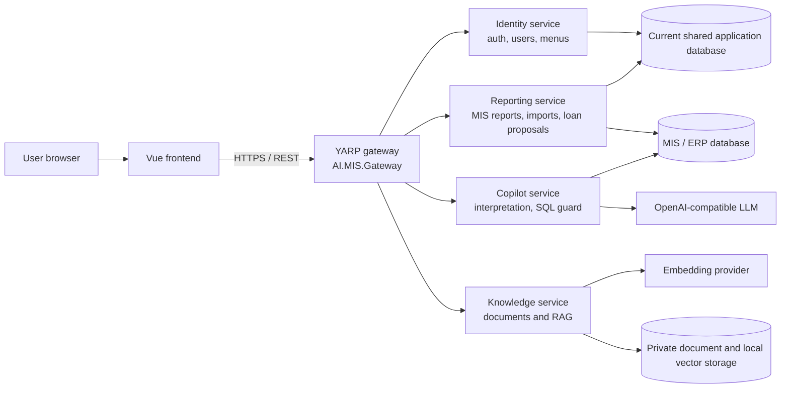

# AI MIS & ERP Copilot

A Vue web client, YARP gateway, and independently deployable ASP.NET Core service hosts for MIS and ERP reporting, analytics, and a read-only AI copilot.

## Microservice Architecture

The backend is being split into independently deployable ASP.NET Core API hosts. The Vue application calls the YARP gateway, which routes each feature path to its owning service. Clean Architecture projects remain shared implementation libraries during this migration; they are not service hosts.



### What is deployed separately

- `AI.MIS.Gateway` routes `/api/auth`, `/api/users`, and `/api/menus` to Identity; `/api/copilot` and `/api/schema-metadata` to Copilot; `/api/documents` to Knowledge; and reporting, Excel import, and loan proposal routes to Reporting.
- `AI.MIS.IdentityService` hosts authentication, user management, and menu administration.
- `AI.MIS.CopilotService` hosts natural-language interpretation and guarded query execution.
- `AI.MIS.KnowledgeService` hosts document upload, indexing, retrieval, and cited answers.
- `AI.MIS.ReportingService` hosts MIS reports, Excel/CSV imports, and the loan proposal API.

Each API service validates JWTs independently. The gateway also validates supplied JWTs, applies a gateway-level request limit, and routes requests. The previous `AI.MIS.Api` host remains available for compatibility and local troubleshooting; the Vue development proxy now targets the gateway at `http://localhost:8080` by default.

### Migration status and current limits

The service hosts currently share the `AI.MIS.Application` and `AI.MIS.Infrastructure` code libraries. Identity and reporting still use the same application database, MIS reporting and Copilot use configured ERP/MIS SQL connections, and Knowledge stores its document/vector index in local persistent files. This is an initial independently deployable service split, not yet full service-owned data isolation. There is no message broker/AuditService, SQL vector store, or automated per-service database migration in this implementation.

### Project layout

```text
frontend/                         Vue 3 + TypeScript application
backend/
├── AI.MIS.Gateway/               YARP reverse proxy and route configuration
├── AI.MIS.IdentityService/       Authentication, users, and menus host
├── AI.MIS.CopilotService/        Copilot query host
├── AI.MIS.KnowledgeService/      Document/RAG host
├── AI.MIS.ReportingService/      Reporting, imports, and loan proposal host
├── AI.MIS.HttpApi/               Shared controller assembly during extraction
├── AI.MIS.ServiceDefaults/       JWT, rate limit, health, and controller filtering
├── AI.MIS.Api/                   Compatibility host
├── AI.MIS.Application/           Shared use cases/contracts during extraction
├── AI.MIS.Domain/                Shared domain types during extraction
├── AI.MIS.Infrastructure/        Shared adapters during extraction
└── deploy/                       Docker Compose and service container build
AI.MIS.Copilot.sln
```

## Features

- JWT login and role-based access for Administrators, MIS Analysts, and Branch Users.
- MIS dashboard and reporting endpoints.
- Authenticated Excel/CSV import saved to `AiMisErpCopilotDb` before reports are displayed, with selectable grouping and measures, graphical summaries, totals, and a worksheet preview. Imported workbooks are scoped to the signed-in user.
- Natural-language question interpretation and guarded read-only SQL query execution.
- PDF, DOCX, TXT, and Markdown upload, indexing, search, and cited answers using retrieval-augmented generation (RAG).
- Menu and user access administration.
- Vue-based dashboard, visualization, document, and administration pages.

## Run the microservice stack

Create a `.env` file in the repository root with deployment-specific values (do not commit secrets):

```dotenv
AUTHENTICATION_SIGNING_KEY=replace-with-a-random-key-at-least-32-characters
APPLICATION_DATABASE_CONNECTION_STRING=Server=...;Database=AiMisErpCopilotDb;...
ERP_READ_ONLY_DATABASE_CONNECTION_STRING=Server=...;Database=...;...
MIS_DATABASE_CONNECTION_STRING=Server=...;Database=...;...
LLM_ENDPOINT=https://api.openai.com/v1/chat/completions
LLM_API_KEY=replace-with-provider-key
LLM_MODEL=replace-with-model-name
EMBEDDINGS_ENDPOINT=https://api.openai.com/v1/embeddings
EMBEDDINGS_API_KEY=replace-with-provider-key
EMBEDDINGS_MODEL=replace-with-embedding-model
```

Start the gateway and API services from the repository root:

```powershell
docker compose --env-file .env -f backend/deploy/docker-compose.yml up --build
```

The gateway listens on `http://localhost:8080`; point the frontend at that URL for local development. The application database must already contain the tables required by the Identity and Reporting features, including `backend/database/Tables/006_ExcelImports.sql`.

## Requirements

- .NET 9 SDK
- Node.js and npm
- SQL Server databases configured for the application and MIS reporting workloads

## Run locally

### 1. Configure the API

Set secrets from the repository root. Use a secure, random JWT signing key of at least 32 characters and database credentials appropriate for your environment:

```powershell
$env:Authentication__SigningKey = 'replace-with-a-random-key-of-at-least-32-characters'
$env:ConnectionStrings__ApplicationDatabase = 'Server=...;Database=AiMisErpCopilotDb;Trusted_Connection=True;TrustServerCertificate=True;'
$env:ConnectionStrings__MISDbConnection = 'Server=...;Database=...;Trusted_Connection=True;TrustServerCertificate=True;'
```

Keep credentials out of source control. For local development, .NET User Secrets can hold configuration for the API project:

```powershell
dotnet user-secrets set 'Authentication:SigningKey' '<random-signing-key>' --project backend/AI.MIS.Api
dotnet user-secrets set 'ConnectionStrings:ApplicationDatabase' '<application-database-connection-string>' --project backend/AI.MIS.Api
dotnet user-secrets set 'ConnectionStrings:MISDbConnection' '<read-only-reporting-database-connection-string>' --project backend/AI.MIS.Api
```

Apply the SQL scripts under `backend/database/Tables/` to the application database and run `backend/database/Seed/003_DemoUsers.sql` if you need the development seed users. Change any development passwords before using the application outside a local environment.

Excel reporting requires `backend/database/Tables/006_ExcelImports.sql` to be applied to `AiMisErpCopilotDb`. After applying it and restarting the API, sign in, open **Visualization → Excel workbook**, and select an `.xlsx`, `.xls`, `.xlsm`, or `.csv` file. The API saves each import and its rows in one database transaction; the chart and table load from the saved report. Imports are visible only to the user who created them. The import limit is 20 MB, 20,000 data rows, and 100 columns.

### 2. Start the microservice stack

Use the Docker Compose command in **Run the microservice stack** above. It starts the gateway on port `8080` and the service hosts on the internal Docker network. If you need to run the compatibility API host directly instead, start it with:

```powershell
dotnet run --project backend/AI.MIS.Api/AI.MIS.Api.csproj
```

The compatibility host serves HTTP at `http://localhost:5252` and is not the gateway. To use it from the frontend, set `VITE_API_URL=http://localhost:5252`. Visual Studio may use IIS Express at `https://localhost:44340`.

### 3. Configure and start the frontend

From the repository root:

```powershell
cd frontend
npm.cmd install
node .\node_modules\vite\bin\vite.js
```

When `VITE_API_URL` is unset, the development server proxies API requests to the gateway at `http://localhost:8080`. Set `VITE_API_URL` only when intentionally targeting another API address; it will be used for both the proxy target and browser requests.

This repository path contains an ampersand (`&`). On Windows, npm command wrappers can misread paths containing it. If `npm.cmd run dev` fails, start Vite with the direct Node command shown above.

## AI and document configuration

Configure the OpenAI-compatible chat endpoint for interpretation and grounded answers using User Secrets or environment variables:

```powershell
dotnet user-secrets set 'Llm:Endpoint' 'https://api.openai.com/v1/chat/completions' --project backend/AI.MIS.Api
dotnet user-secrets set 'Llm:ApiKey' '<provider-api-key>' --project backend/AI.MIS.Api
dotnet user-secrets set 'Llm:Model' '<model-name>' --project backend/AI.MIS.Api
```

For document embeddings, configure an endpoint, key, and model. Use the same model and dimensions for indexing and querying; changing embedding models requires reindexing documents.

```powershell
dotnet user-secrets set 'Rag:EmbeddingsEndpoint' 'https://api.openai.com/v1/embeddings' --project backend/AI.MIS.Api
dotnet user-secrets set 'Rag:EmbeddingsApiKey' '<provider-api-key>' --project backend/AI.MIS.Api
dotnet user-secrets set 'Rag:EmbeddingsModel' '<embedding-model>' --project backend/AI.MIS.Api
```

Documents and the local vector index are stored under `App_Data/documents` by default. In a deployed environment, configure `Rag:StoragePath` to private persistent storage. Do not serve this directory as static web content.

## API overview

- `POST /api/auth/login` — authenticate and receive a JWT.
- `GET /api/misReports` — load dashboard/report data.
- `GET /api/schema-metadata` — inspect the approved schema metadata.
- `POST /api/copilot/interpret` — interpret a question without executing proposed SQL.
- `POST /api/copilot/query` — validate and execute an authorized read-only query.
- `/api/documents` — list, upload, index, search, and ask questions about documents.
- `/api/menus` and `/api/users` — menu and user administration.

The copilot query endpoint accepts one approved read-only `SELECT` statement and applies a query timeout. Use a read-only database principal; application validation does not replace database permissions. Branch-user queries are restricted to authorized branch scopes.

## Security notes

- Store API keys, database credentials, and production JWT signing keys in a secret manager or environment configuration, never in the frontend or checked-in settings.
- Use TLS for deployed traffic.
- Keep document and vector storage private and persistent.
- Review database permissions and role assignments before deployment.
